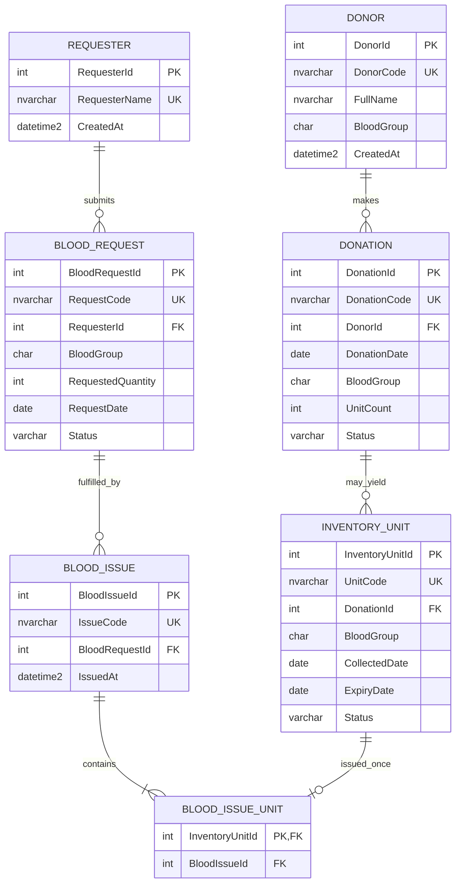

# HemoTrack database design proposal (Phase 5)

**Status: adopted design defaults.** The schema proposal for `HemoTrackDB` uses minimal donor data, reusable requesters, multi-unit donations, and quarantined units until acceptance. The SQL scripts are prepared but have not been executed in the unavailable SQL Server instance.

## Model

## Rules represented

- `Donation` belongs to one donor. Its status is `Screening`, `Accepted`, or `Rejected`.
- `Donation.BloodGroup` is a snapshot of the donor's group when the donation is recorded. The API validates it against the donor under a transaction at creation time; later donor profile edits do not rewrite historical donations.
- Inventory is individual-unit based. Each unit belongs to its source donation; its status is `Quarantined`, `Available`, `Issued`, or `Discarded`. New units default to `Quarantined`.
- A composite foreign key from `(InventoryUnit.DonationId, InventoryUnit.BloodGroup)` to the matching donation pair prevents inventory units from being assigned a different group than their source donation.
- Only units from accepted donations may be released as available. Cross-table validation and release will be enforced by the approved database workflow (stored procedure/transaction in later phases), not by a misleading standalone `CHECK` constraint.
- A request belongs to a requester and asks for a positive number of units. Statuses are `Pending`, `Approved`, `PartiallyFulfilled`, `Fulfilled`, `Rejected`, and `Cancelled`.
- `BloodIssue` groups one issue operation for one request. `BloodIssueUnit` records each exact unit. Its primary key on `InventoryUnitId` prevents issuing one unit twice.
- Issued quantity and request progress are derived from issue-unit rows, avoiding a manually editable stock total or duplicated issued-quantity counter.
- An issue transaction must lock and validate request and unit rows, require an approved/partially fulfilled request, match the request's blood group, require accepted-donation/available/unexpired units, insert issue links, mark units issued, and update request status atomically. Any failure rolls back all changes.
- IDs are database-generated integers. Separate unique human-readable codes support the UI. UTC timestamps use `datetime2` and `SYSUTCDATETIME()`.

## Adopted design decisions

1. Requester/hospital names are stored separately and reused.
2. A donation may yield multiple inventory-unit records, with `UnitCount` on the donation.
3. Inventory units default to `Quarantined`; the acceptance procedure releases units only after an accepted screening state.
4. The demo stores no donor contact/address data.

The app is an educational demonstration. Blood group matching is only a project workflow rule, not medical compatibility advice.
