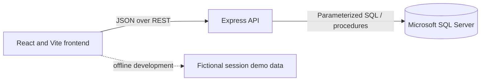

# Blood Bank Inventory and Donor Management System

## 1. Title Page

**Project:** HemoTrack — Blood Bank Inventory and Donor Management System  
**Course:** Database Management Systems Project-Based Learning  
**Student / institute / guide:** Add details required by the official college template.

## 2. Table of Contents

1. Title Page  
2. Table of Contents  
3. Abstract  
4. Introduction  
5. System Design  
6. Implementation  
7. Conclusion  
8. References

## 3. Abstract

HemoTrack is an educational web application for demonstrating donor records, donation screening states, unit-level blood inventory, hospital requests, issue tracking, and operational reports. The interface uses React and communicates with an Express API. Microsoft SQL Server is the planned persistent store. SQL views derive eligible stock from individual units; stored procedures are designed to create inventory after acceptance and issue units within a transaction. The application uses fictional records and is not clinically validated. Database execution and end-to-end persistence remain to be verified against a running SQL Server instance.

## 4. Introduction

### About the Project

The project models common blood-bank recordkeeping concepts for DBMS learning. It separates the frontend, API, and relational database. In offline development, the frontend clearly labels its temporary demonstration data.

### Project Outcomes

- Responsive dashboard and donor, donation, inventory, request, issue, and reporting screens.
- Donations can represent 1–100 sample units; SQL acceptance creates the matching unit records. Offline edits remain session-only and do not add inventory.
- Express API with server-side validation and parameterized SQL access.
- SQL Server schema proposal with keys, checks, indexes, views, stored procedures, and an inventory status audit trigger.
- A transactional issue procedure that validates request status, blood group, donation acceptance, unit availability, and expiry before updating issue, unit, and request records.

### Project Objectives

- Demonstrate normalization, PK/FK relationships, constraints, joins, aggregates, views, stored procedures, triggers, indexes, and transaction concepts.
- Calculate stock from individual inventory-unit records.
- Keep invalid, expired, and previously issued units out of the eligible issue workflow.
- Present searchable records and date/status-filtered reports.

## 5. System Design

### System Architecture

### Modules

1. Dashboard and alerts.
2. Donor records.
3. Donation records and screening state.
4. Individual-unit inventory and expiry review.
5. Requests and fulfillment progress.
6. Issues with unit-level history.
7. Reports, filters, CSV export, and print layout.

### ER Diagram

See [`../database/phase-5-schema-proposal.md`](../database/phase-5-schema-proposal.md) for the Mermaid ER diagram and cardinalities. The model includes Donor, Donation, InventoryUnit, Requester, BloodRequest, BloodIssue, and BloodIssueUnit. Inventory status changes are written to InventoryStatusAudit.

## 6. Implementation

### Technology

- Frontend: React, Vite, Tailwind CSS, React Router, Lucide, Recharts.
- Backend: Node.js, Express, `mssql` with `msnodesqlv8` for Windows Integrated Authentication.
- Database: Microsoft SQL Server and T-SQL.

### SQL Queries, Views, Trigger, and Procedures

The SQL scripts are in [`../database/`](../database/README.md). `vEligibleInventory` counts only available, unexpired units from accepted donations. `vBloodRequestFulfillment` joins requests to issue-unit rows to calculate issued and remaining quantities. `usp_SetDonationStatus` creates units exactly once when a screening donation is accepted. `usp_IssueBloodUnits` validates and updates issue state under a transaction. `trg_InventoryUnit_StatusAudit` records status transitions. `04_report_queries.sql` demonstrates joins, aggregates, grouping, filtering, sorting, and `HAVING`.

### API

The API validates request shapes, uses SQL parameters, provides safe error responses, and relies on Windows Integrated Authentication. `GET /api/health/live` checks the process; `/api/health/ready` checks SQL connectivity. The project includes validation tests; see [`Verification.md`](Verification.md).

### Sample Output Screenshots

Capture genuine screenshots after SQL Server is running and the database seed scripts have been applied. Recommended evidence: dashboard, donor list, donation acceptance, inventory after acceptance, request progress, issue history after a transactional issue, and filtered report. Do not present offline demo data as database-backed results.

### Results and Limitations

Frontend production build and lint pass. Backend syntax checks and five input-validation tests pass. The SQL Server instance was unavailable in the build environment, so SQL scripts, database persistence, stored procedures, trigger, and transactional/concurrency behavior are implemented but not yet verified against SQL Server. The app is an academic demo and must not be used for medical decisions.

## 7. Conclusion

HemoTrack provides a structured full-stack DBMS project foundation and demonstrates the intended data model and transactional inventory workflow. The remaining delivery step is to run the database scripts and end-to-end checks on a reachable SQL Server, then replace the screenshot placeholders with genuine captures from that verified run.

## 8. References

- Microsoft Learn, [Node.js driver for SQL Server](https://learn.microsoft.com/en-us/sql/connect/node-js/node-js-driver-for-sql-server?view=sql-server-ver17).
- Microsoft Learn, [Connecting to SQL Server from Node.js](https://learn.microsoft.com/en-us/sql/connect/node-js/step-3-proof-of-concept-connecting-to-sql-using-node-js?view=sql-server-2017).
- Express, [official API documentation](https://expressjs.com/en/5x/api.html).
- React, [official documentation](https://react.dev/).
- Add course textbook, college report template, and any instructor-required references before submission.
